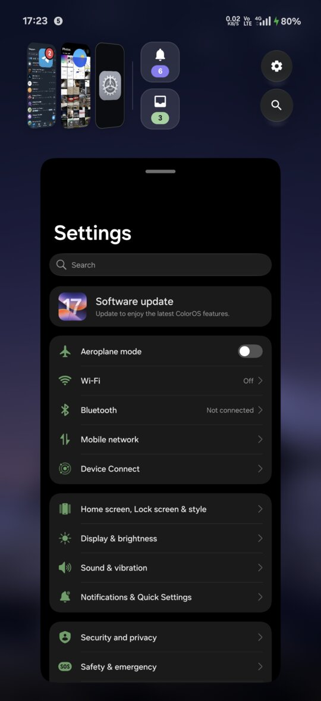
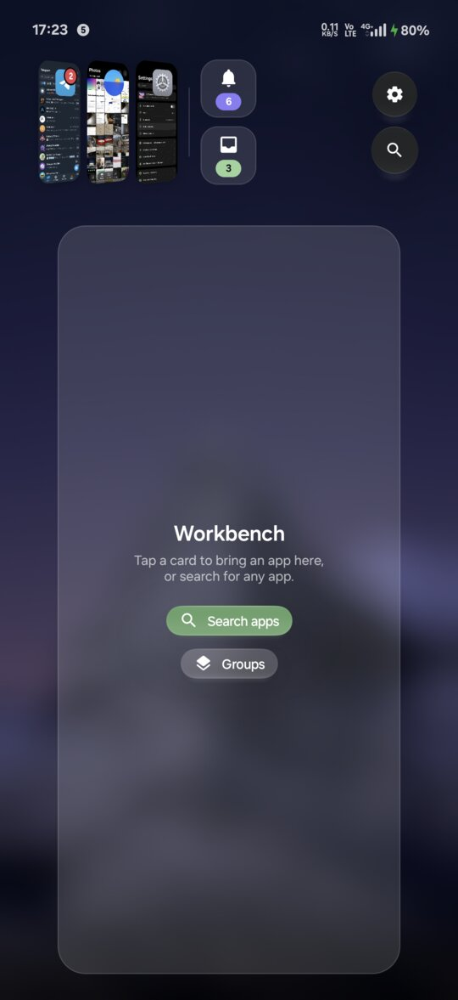
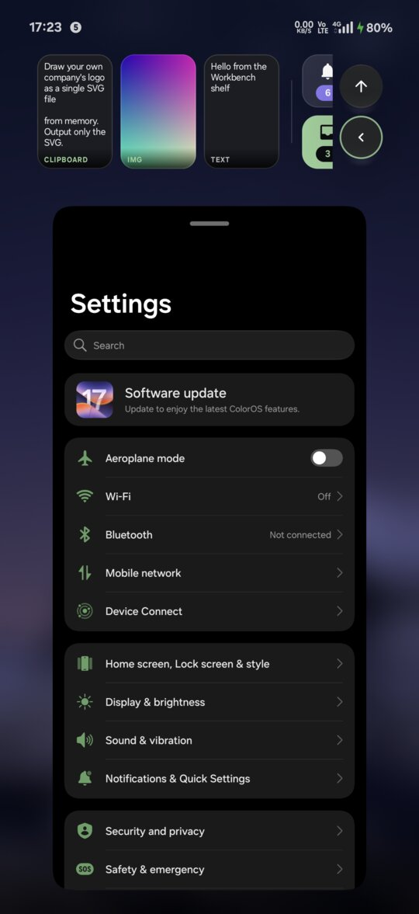
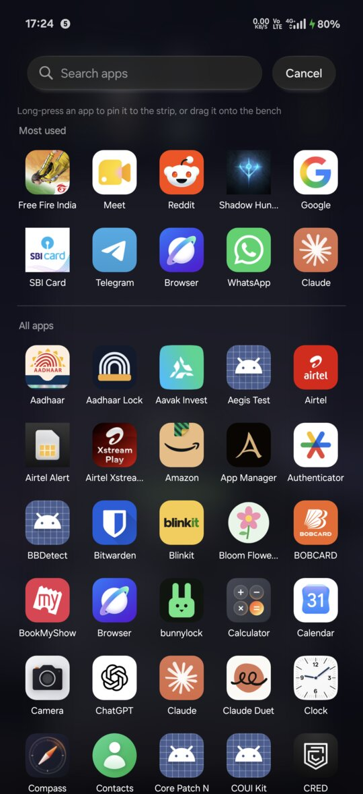
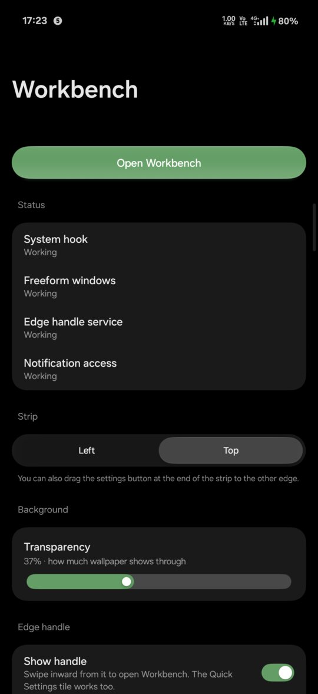

# Workbench

A desktop-style multitasking bench for ColorOS 17. Recent apps sit in a strip along the edge, and the app you're
working in floats in one big main window. You can switch apps, split the window in two, open groups of apps
together, read notifications and keep copied text and images in a shelf.

I built it for my OnePlus 15 and use it every day. Other ColorOS 17 phones should work, but I haven't tried them.

<p>
  
  
  
  
</p>

## What you need

- A rooted phone (Magisk or KernelSU)
- LSPosed (or Vector)

It won't run without both. The module hooks into the system so Workbench can move and resize app windows the
way ColorOS's own floating windows do.

## Install

1. Download the APK from [Releases](../../releases) and install it. It's built for arm64-v8a.
2. In LSPosed, enable the **Workbench** module and tick both scopes:
   - **System Framework** (`android`)
   - **System UI** (`com.android.systemui`)
3. Reboot. Reboot again after every update; LSPosed will remind you.
4. Open **Workbench**. Under **Status**, tap **Fix with root** and grant root. This turns on freeform windows,
   the edge handle and notification access. All four rows should say **Working**.



## Opening it

Swipe in from the thin handle on the screen edge, or add the **Workbench** tile to Quick Settings.

## Using it

| To | Do this |
|---|---|
| Put an app in the main window | Tap its card in the strip |
| Pin, close and other card actions | Long-press a card |
| Go to the next or previous app | Swipe sideways on the handle above the main window |
| Minimize, expand, split, zoom, close | Tap the handle above the main window |
| Find an app | Tap the search circle |
| Open a group of apps | Hold the search circle |
| Split the main window | Drag an app from search onto the lower half, or pick Split from the handle menu |
| Read notifications | Tap the bell tile. Tapping a notification opens it in the main window |
| Use the shelf | Tap the inbox tile. Drag an item into any app, or tap it to copy, share or delete |
| Send the shelf to FileDock | Tap the up arrow while the shelf is open |
| Move the strip to the left or top edge | Drag the settings circle, or change it in Settings |
| Leave | Tap outside the main window, or go home |

## If something breaks

Turn the module off in LSPosed and reboot. If the phone won't boot, use LSPosed's safe mode or disable the
module from recovery through Magisk or KernelSU.

Clipboard history only starts after the reboot in step 3.

## Building

There's no Gradle wrapper in the repo, so use a local Gradle (9.x) and point `local.properties` at your
Android SDK:

```
gradle assembleRelease
```

The APK lands in `app/build/outputs/apk/release/`. The `hidden` module only holds compile-time stubs for
framework and Xposed APIs; nothing from it ends up in the APK.
